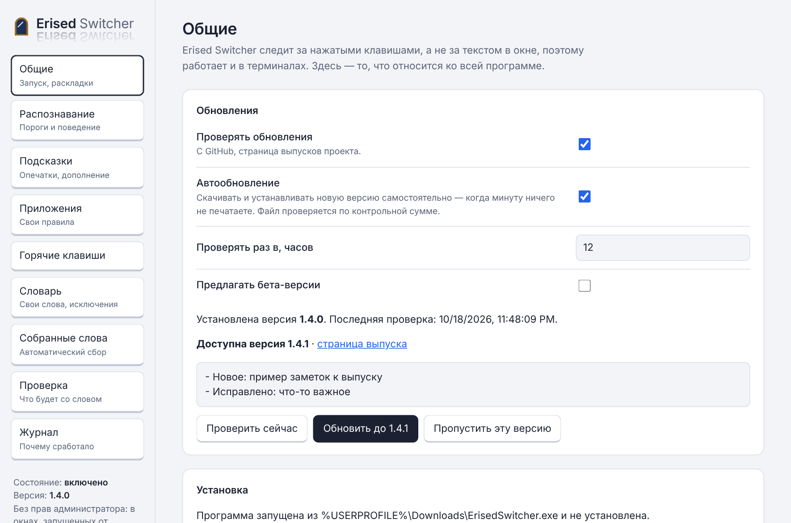
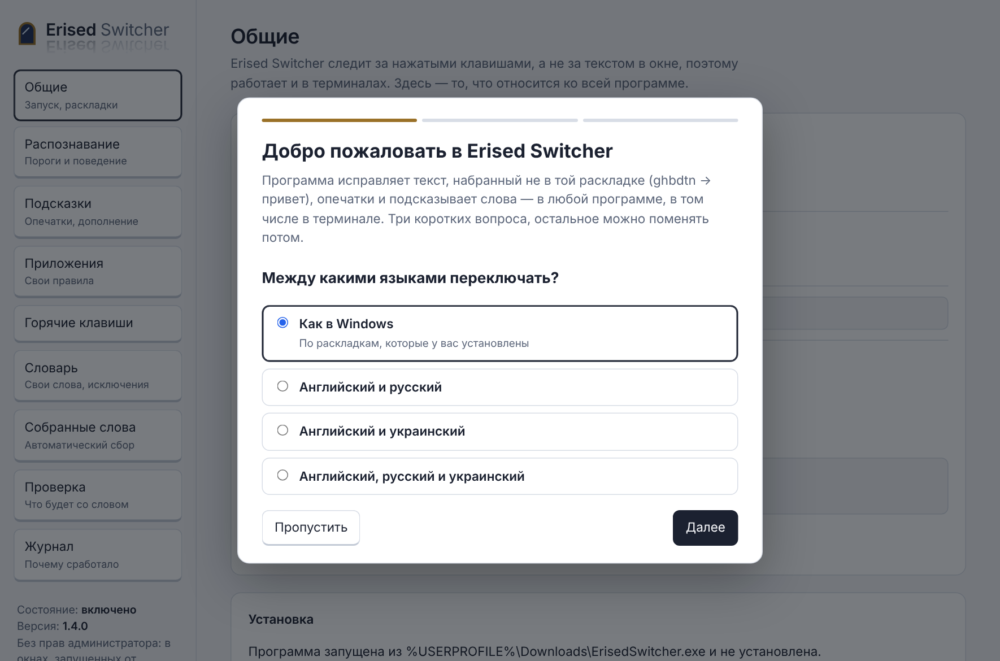
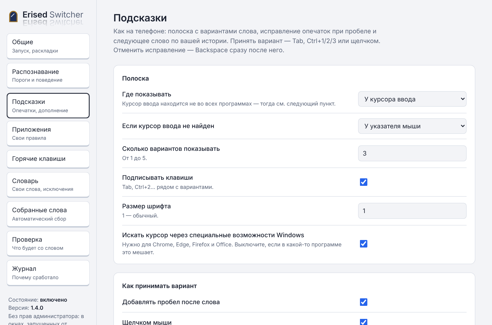
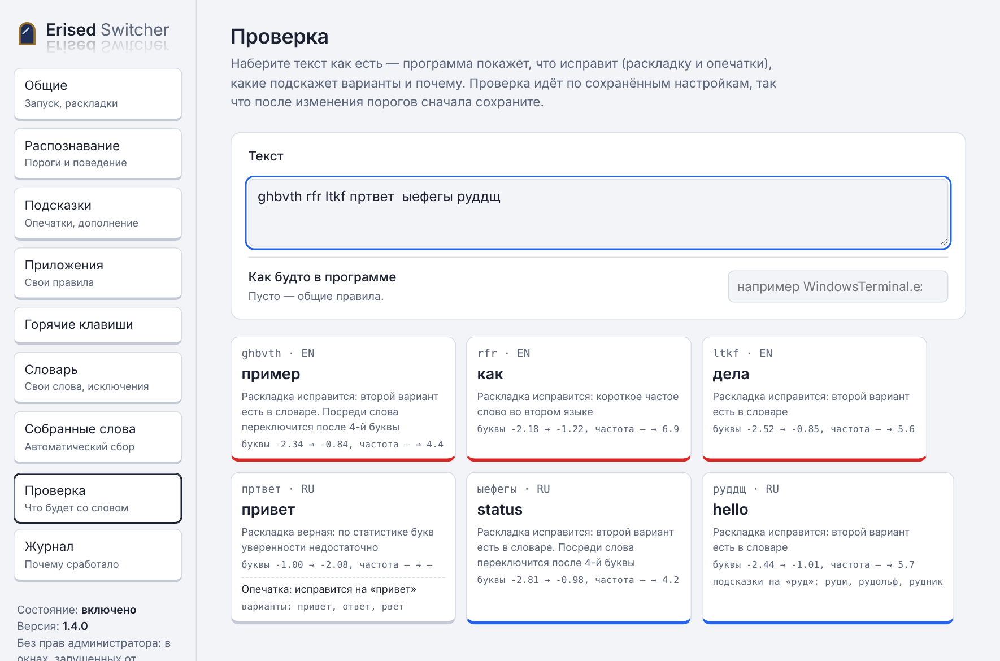

# Erised Switcher

*Erised stra ehru oyt ube cafru oyt on wohsi.*

**[English version →](README.md)**

Автоматическое переключение раскладки для Windows 10/11 — английский, русский и украинский. Как Зеркало Еиналеж, показывает не то, что вы набрали, а то, что хотели написать: `ghbdtn` превращается в «привет», `руддщ` — в `hello`.

Замечает слово, набранное не в той раскладке, стирает его, печатает правильно и переключает раскладку.

- **Работает в терминалах** (Windows Terminal, cmd, PowerShell, WSL, mintty и др.) и в программах, которые не отдают свой текст. Программа запоминает не текст из окна, а нажатые клавиши, поэтому ей неважно, что умеет окно.
- **Тонкая настройка всего**: пороги уверенности, свои правила для каждой программы, горячие клавиши, паузы ввода, способ определения раскладки.
- **Подсказки и исправление опечаток, как на телефоне**: полоска с вариантами у курсора, исправление опечаток при пробеле (Backspace — вернуть), предсказание следующего слова по вашей истории набора.
- **Сама собирает слова**: отменили исправление — слово становится исключением; перевели слово вручную — оно начнёт исправляться само; незнакомое слово, которое вы набираете снова и снова, перестаёт считаться ошибкой. Каждое слово хранится один раз со счётчиком. Всё собранное видно и редактируется в настройках.



## Скачать и установить

Последняя версия — на странице [Releases](https://github.com/NickolasFleim/ErisedSwitcher/releases/latest): `ErisedSwitcher.exe` для обычных ПК, `ErisedSwitcher-arm64.exe` для Windows на ARM.

При первом запуске программа предложит установиться — только для вас, без прав администратора: в `%LOCALAPPDATA%\Programs\Erised Switcher`, с ярлыком в «Пуске» и записью в «Параметры → Приложения» (оттуда же и удаляется, как обычное приложение). «Нет» — просто работать из текущей папки.

Затем мастер первого запуска задаст три вопроса: между какими языками переключать, какой клавишей исправлять вручную и что делать с опечатками. Остальное можно поменять потом.



**winget** (после того как пакет примут в каталог winget):

```
winget install NickolasFleim.ErisedSwitcher
```

Установленную через winget программу обновляет winget, встроенное обновление тогда выключено.

**Переносная версия**: положите рядом с exe пустой файл `portable.txt` — данные будут в папке `data` рядом, установку программа предлагать не будет.

**SmartScreen и антивирусы.** Файл пока не подписан цифровой подписью, поэтому SmartScreen может показать «Система Windows защитила ваш компьютер» («Подробнее → Выполнить в любом случае»), а некоторые антивирусы настороженно относятся к любой программе, перехватывающей клавиатуру. Исходный код открыт, каждый выпуск собирается GitHub Actions из помеченного тегом коммита, контрольная сумма SHA-256 каждого файла видна на странице выпуска. Как будет добавлена подпись — в [docs/SIGNING.md](docs/SIGNING.md).

## Начало работы

1. В трее — значок с текущей раскладкой (синий EN, красный RU, янтарный UA, серый — выключено).
2. Щелчок по значку открывает настройки в отдельном окне. Правый щелчок — меню.
3. Чтобы программа работала в окнах, запущенных от администратора (например, «Терминал (администратор)»), её саму нужно запустить от администратора: пункт меню «Перезапустить от администратора». Это ограничение Windows для всех таких программ.

Настройки и словари лежат в `%APPDATA%\Erised Switcher`.

## Языки

Английский, русский и украинский. По умолчанию — те, чьи раскладки установлены в Windows; на вкладке «Общие» можно выбрать пару (EN+RU, EN+UK) или все три.

Если установлены обе кириллические раскладки, программа сама выбирает подходящую слову: `ghbdsn` → «привіт», `ghbdtn` → «привет». С кириллицы исправляет на английский, с английского — на ту кириллицу, которой вы пользовались последней. Повторное нажатие горячей клавиши перебирает остальные раскладки.

## Подсказки и опечатки

Пока вы печатаете, у курсора ввода появляется полоска с вариантами: дополнение слова (`здравс` → «здравствуйте»), исправление опечатки (`пртвет` → «привет»), а после пробела — следующее слово, которое вы обычно пишете после предыдущего («доброе» → «утро»).

| Как | Что делает |
|---|---|
| Tab | Принять первый вариант (пока видна полоска; иначе Tab работает как обычно) |
| Ctrl+1 / Ctrl+2 / Ctrl+3 | Принять вариант по номеру |
| Щелчок по варианту | Принять его (фокус остаётся в вашей программе) |
| Стрелка вправо | Принять первый вариант — включается в настройках |
| Esc | Скрыть полоску |
| Backspace сразу после исправления | Вернуть как было (и больше это слово не исправлять) |

**Исправление опечаток** учитывает расположение клавиш: промах по соседней клавише, перестановка букв, пропущенная двойная буква считаются «дешёвыми» ошибками. Исправление применяется при пробеле или Enter, только когда программа уверена: на синтетических опечатках около 69% исправляются сами, из них неверных меньше 2%; в остальных случаях правильный вариант просто стоит первым в полоске (верный первый вариант — в 88–89% случаев). Режим «Только подсказывать» не меняет текст сам.

После каждого автоматического исправления у курсора на секунду появляется, что изменилось, — `пртвет → привет`, — чтобы вы заметили исправление и при желании отменили его Backspace. Выключается на вкладке «Общие».

Что не трогается: слова, которые существуют (проверка по ~630 тыс. русских, ~540 тыс. английских и ~124 тыс. украинских форм — чтобы не «исправлять» редкие, но правильные слова), слова с заглавной буквы посреди предложения (обычно имена), аббревиатуры, слова с цифрами, через дефис, ваши слова и исключения. Частые ошибки написания, которые сами есть в словаре (`recieve`, `извените`), исправляются, только если правильный вариант в сотни раз частотнее; поэтому «щас» и «вообщем» останутся как есть.

**Следующее слово.** Пока ваша история набора мала, подсказываются частые сочетания из встроенной базы («может быть», «будь ласка», «if you»); ваши сочетания всегда важнее. **История набора** (`typing.json`) хранит только известные слова и пары «слово → следующее слово» со счётчиками, только на этом компьютере. Поля паролей не учитываются. Посмотреть, удалить пару или стереть всё — на вкладке «Подсказки».

В терминалах и редакторах кода подсказки и исправление опечаток по умолчанию выключены — там свои дополнения. Всё включается и настраивается для каждой программы отдельно.



## Горячие клавиши по умолчанию

| Клавиши | Что делает |
|---|---|
| Shift дважды | Если текст выделен — сконвертировать выделение. Иначе — последнее слово. Ещё раз дважды — вернуть. Если нет ни слова, ни выделения — переключить раскладку |
| Shift+Pause | Сконвертировать фразу (всё с начала строки) |
| Ctrl+Shift+Pause | Сконвертировать выделенный текст |
| Pause | Отменить исправление |
| Backspace сразу после исправления | Отменить его и запомнить слово как исключение |
| Ctrl+Alt+Pause | Включить или выключить |
| Tab, Ctrl+1/2/3, Esc | Подсказки (см. выше; действуют, только пока видна полоска) |

Всё меняется на вкладке «Горячие клавиши». Поддерживаются сочетания (`Ctrl+Alt+Z`), двойные нажатия (`DoubleShift`, `DoubleRCtrl`) и одиночные нажатия правых/левых модификаторов (`RCtrl`). «Конвертировать слово» и «Конвертировать выделение» можно повесить на одну клавишу. Остальные совпадения настройки не дадут сохранить и подскажут, где конфликт.

Выделение программа угадывает по вашим действиям: протяжка или двойной щелчок мышью, Shift+щелчок, Shift+стрелки/Home/End, Ctrl+A. Любой набор, Backspace или стрелка без Shift считаются снятием выделения.

**Эксперимент: чтение текста у курсора.** Обычно программа знает только то, что набрано после последнего щелчка. Если включить «Читать текст у курсора после щелчка мышью» (вкладка «Общие»), она прочитает текст перед курсором через специальные возможности Windows (UI Automation): щёлкните после уже написанного слова или фразы — и двойной Shift их сконвертирует. Работает в Блокноте, Word, браузерах и многих других программах, но не во всех. Сами по себе прочитанные слова не исправляются.

## Терминалы

Для терминалов уже есть правило «Терминалы» (вкладка «Приложения»):

- исправляются только словарные слова и слова из списка «всегда правильные» — туда уже внесены частые команды (`git`, `cd`, `ls`, `docker`, `kubectl`…), поэтому `пше ыефегы` станет `git status`, а ваши пути и ключи не тронутся;
- слова с `/ \ $ = @ _ : ~` не трогаются;
- исправление на Enter происходит до выполнения команды;
- для классических окон консоли раскладка читается через API консоли — именно там другие переключатели ошибаются;
- исправление печатается символами Unicode, так что от раскладки терминала оно не зависит;
- выделение копируется через Ctrl+Shift+C, а результат не выделяется заново.

Если какая-то команда исправляется зря, отмените исправление Backspace — она попадёт в исключения. Если нужное слово не исправляется — сконвертируйте его двойным Shift, и оно начнёт исправляться само.

## Как подобрать настройки

- **Точность на вашем наборе** (вкладка «Журнал»): сколько исправлений вы отменили (ошибки программы) и сколько слов сконвертировали сами (пропуски) за 7 и 30 дней — только счётчики, без текста. Режим «Только наблюдать»: программа решает как обычно, но ничего не меняет, а записывает, что исправила бы; разберите список и отметьте ошибки — эти слова станут исключениями.
- **«Проверка»** — наберите слова и увидите, что с ними будет и почему, с числами оценок. Можно указать программу, чтобы проверить её правило.
- **«Журнал»** — включите на вкладке «Общие», и программа будет записывать каждое решение с объяснением (только в памяти, до выхода).
- **Если исправляет лишнее** — включите «Только по словарю», увеличьте «Короткие слова: минимальная частотность» или уменьшите «Текущий вариант не лучше чем».
- **Если пропускает** — выключите «Только по словарю» для этой программы, уменьшите «Минимальная длина слова».
- **Если в программе остаются лишние буквы или текст путается** — увеличьте паузы ввода в её правиле или переключите «Как печатать исправление» на «Клавишами».
- **Если выделение не копируется** — проверьте в правиле программы «Чем копировать выделение».



Файлы `config.json` и `words.json` можно править и вручную — программа перечитает их сама через пару секунд.

## Перенос на другой компьютер и резервная копия

«Общие → Перенос и резервная копия»:

- **«Сохранить в файл…»** — настройки, правила приложений, свои и собранные слова одним файлом `erised-settings.json` (по желанию — вместе с историей набора). На другом компьютере — **«Загрузить из файла…»**.
- **Папка для резервной копии** — например, папка в OneDrive или на флешке. При каждом изменении настроек и словаря программа сама сохраняет туда `erised-settings.json`.

## Обновления

Программа сама проверяет [выпуски на GitHub](https://github.com/NickolasFleim/ErisedSwitcher/releases) — через 45 секунд после запуска и затем раз в 12 часов.

- **Автообновление** (галочка на вкладке «Общие», включена по умолчанию): новая версия скачивается и устанавливается сама, когда вы минуту ничего не печатаете. Программа на секунду закрывается и запускается снова, затем сообщает «Erised Switcher обновлён до …».
- Без галочки — уведомление о новой версии; обновить можно кнопкой в настройках или пунктом меню значка. Там же — «Проверить сейчас», заметки к выпуску и «Пропустить эту версию».
- Файл обновления сверяется с контрольной суммой SHA-256, которую GitHub публикует для каждого файла выпуска; если она не совпадает, обновление отменяется.
- **Бета-версии**: галочка «Предлагать бета-версии» — и вы будете получать предварительные выпуски (теги вида `v1.5.0-beta.1`).
- Настройки, словари и история набора при обновлении не трогаются.

## Что-то пошло не так?

При ошибке программа продолжает работать, сохраняет отчёт в `%APPDATA%\Erised Switcher\crash` и показывает уведомление; аварийное завершение будет замечено при следующем запуске. Кнопка «Журнал → Сообщить об ошибке на GitHub» открывает форму с уже заполненными версиями программы и Windows, раскладками, последним сбоем и служебным журналом. Набранного текста и имени пользователя в отчёте нет — но перед отправкой всё равно просмотрите текст.

## Как это устроено

- Перехват клавиатуры (`WH_KEYBOARD_LL`) хранит текущее слово как последовательность нажатий с Shift/CapsLock. Слово можно «прочитать» в любой раскладке без обращения к окну.
- Решение о раскладке: словари на ~150 тыс. русских, ~90 тыс. английских и ~88 тыс. украинских слов с частотами, плюс модель сочетаний букв для незнакомых слов. На 10 000 самых частых слов ловится около 99% ошибок раскладки; среди 20 000 редких слов, набранных правильно, ложных срабатываний около 0,08%. На настоящих предложениях (тестовые наборы Universal Dependencies: 1500 русских, 1150 английских), набранных в правильной раскладке, меняется 0,23% русских и 0,05% английских слов (в основном редкие слова, «исправленные» как опечатки); набранных целиком не в той раскладке восстанавливается 99,7% русских и 99,8% английских слов. Замер: `ERISED_EVAL=<папка с .conllu> go test ./internal/engine -run TestEval -v`. Русский или украинский — по словарям и буквам, которые есть только в одном из языков (і ї є ґ / ы э ъ ё).
- Опечатки: компактный индекс похожих слов (SymSpell, ~25 МБ в памяти, строится в фоне за секунду) и взвешенное расстояние Дамерау–Левенштейна с учётом соседних клавиш; фильтр Блума со всеми встречавшимися формами слов. Подсказки считаются примерно за 0,15 мс на нажатие.
- Исправление: Backspace, ввод через `SendInput` (Unicode или клавиши), переключение раскладки сообщением `WM_INPUTLANGCHANGEREQUEST`. Нажатия, сделанные во время исправления, придерживаются и повторяются после него, поэтому быстрый набор не теряется.
- Выделение конвертируется через буфер обмена, прежнее текстовое содержимое буфера затем возвращается.
- Окно настроек — отдельный процесс той же программы (`ErisedSwitcher.exe --settings`, WebView2), так что сбой WebView2 не остановит исправление раскладки. Настройки доступны только с `127.0.0.1` и по секретной ссылке.
- Поля паролей не обрабатываются. Набранный текст никуда не отправляется.

## Сборка из исходников

Нужен Go 1.23+. Все зависимости лежат в папке `vendor`, интернет не нужен. В Windows: `build.bat`. Где угодно:

```
GOOS=windows GOARCH=amd64 go build -trimpath -ldflags "-H windowsgui -s -w" -o ErisedSwitcher.exe ./cmd/erised
go test ./...
```

`ErisedSwitcher.exe --selftest report.txt` проверяет на настоящей Windows то, что не проверить обычными тестами: перехват клавиатуры, полоску подсказок, сервер настроек, буфер обмена и установку (во временных папках). CI запускает её на `windows-latest` при каждом изменении.

Структура: `internal/engine` — логика (тестируется без Windows), `internal/predict` — подсказки и опечатки, `internal/lang` — словари и модель, `internal/keymap` — раскладки, `internal/config` — настройки, `internal/words` — собранные слова, `internal/webui` — страница настроек, `internal/settingswin` — её окно, `internal/update` и `internal/app/updater.go` — обновления, `internal/win` и `internal/app` — всё, что относится к Windows. Значок, сведения о версии и манифест: `cmd/erised/winres` (собираются [go-winres](https://github.com/tc-hib/go-winres)). Словари пересобираются скриптом `tools/gendict.py` из [FrequencyWords](https://github.com/hermitdave/FrequencyWords), стартовая база следующих слов — `tools/genpairs.py` из [Universal Dependencies](https://universaldependencies.org/).

## Выпуск новой версии

1. Поменять `Version` в `internal/app/app.go` и добавить раздел `## X.Y.Z` в `CHANGELOG.md`.
2. Закоммитить и отправить тег: `git tag vX.Y.Z && git push origin main vX.Y.Z`.
3. GitHub Actions (`.github/workflows/release.yml`) проверит, соберёт обе версии exe со сведениями о версии, выполнит самопроверку, подпишет их (если заданы секреты подписи) и опубликует выпуск с заметками из `CHANGELOG.md` и манифестами winget. Тег с дефисом (`v1.5.0-beta.1`) публикуется как бета-версия.

## Что пока не умеет

- Окна, запущенные от администратора, — только если и программа запущена от администратора.
- В программах, которые не сообщают положение курсора ввода, полоска появится у указателя мыши (или внизу экрана — как выберете).
- Если в буфере обмена была картинка или файл, после конвертации выделения там останется прежний текст, а не они.
- В терминале выделение — это текст на экране, а не в строке ввода; для строки ввода удобнее «Сконвертировать фразу».

## Лицензия

Erised Switcher — свободная программа: её можно распространять и изменять на условиях **GNU General Public License версии 3 или более поздней** — см. [LICENSE](LICENSE). Сторонние данные и библиотеки перечислены в [NOTICE.md](NOTICE.md).
